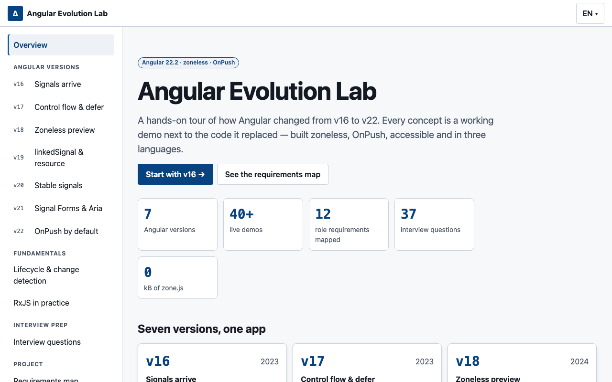
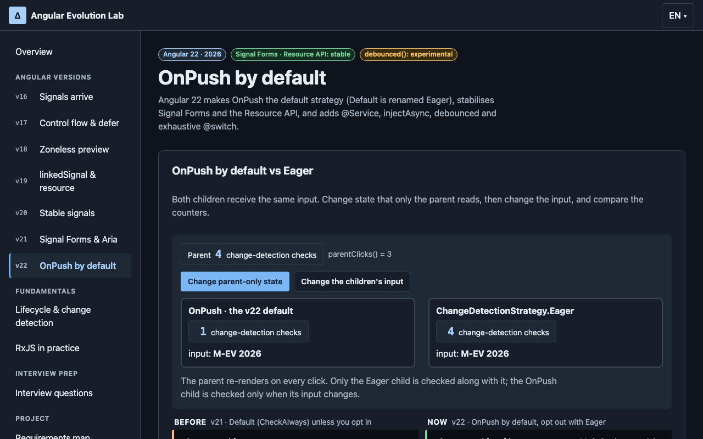
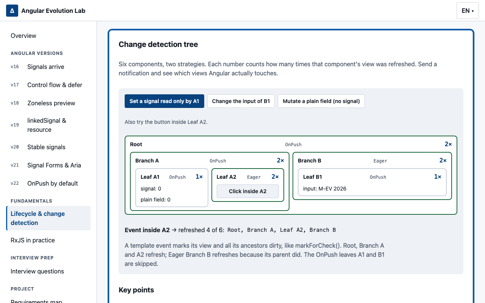
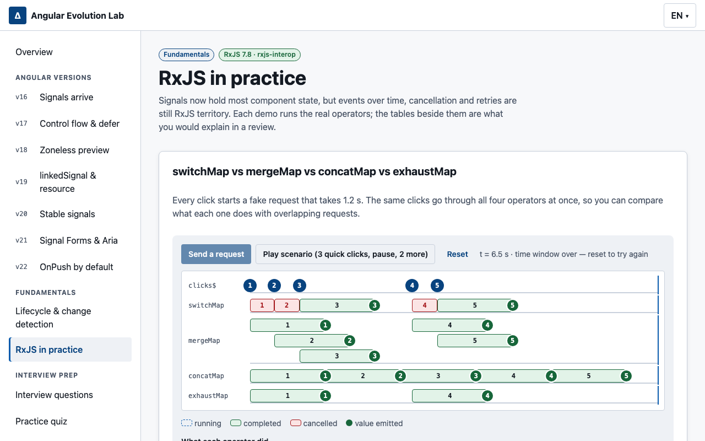
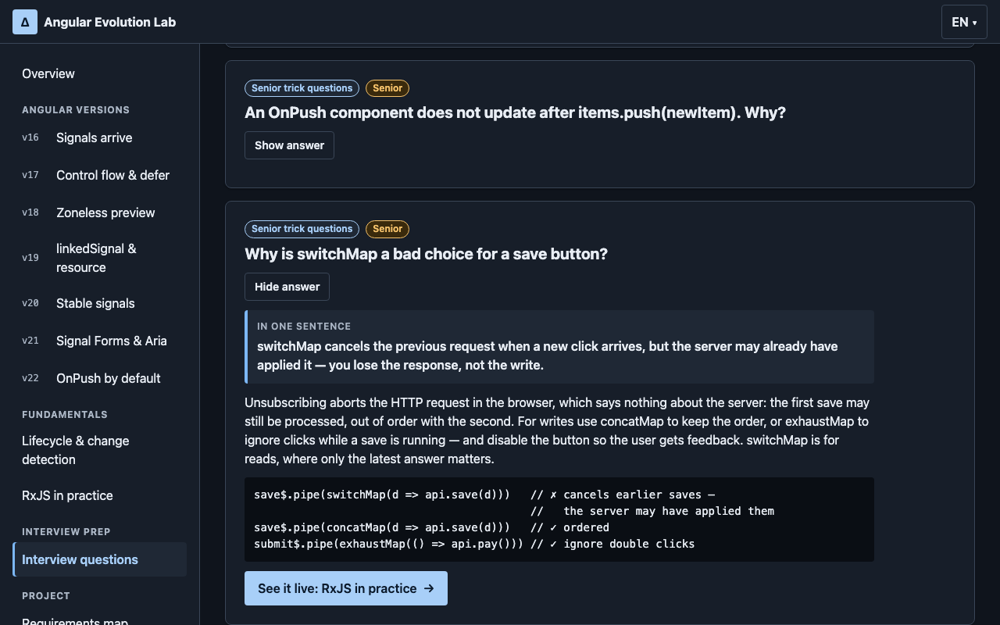
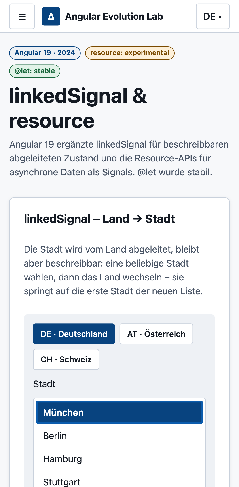

# Angular Evolution Lab

A working tour of how Angular changed from **v16 to v22**. Every concept is a live demo next to the
code it replaced, and every demo maps to a requirement of a Senior Frontend role (automotive, DACH).
The app itself is built the v22 way: zoneless, OnPush by default, signals first, accessible, and in
English, Spanish, German and Lithuanian.



## Quick start

Requires **Node 24 LTS** (Angular CLI 22 needs Node ≥ 22.22.3 or ≥ 24.15). The version is pinned in
`.nvmrc` and `engines`.

```bash
nvm use            # Node 24.22.1
npm ci
npm start          # http://localhost:4200
```

| Command                                                       | What it does                                                                |
| ------------------------------------------------------------- | --------------------------------------------------------------------------- |
| `npm start`                                                   | Dev server                                                                  |
| `npm run build`                                               | Production build (budgets: initial 300 kB warning / 500 kB error)           |
| `npm test` / `npm run test:ci`                                | Jest unit tests / with coverage (≥ 80 % enforced)                           |
| `npm run e2e`                                                 | Playwright on Chromium, Firefox, WebKit and a Pixel 7 viewport              |
| `npm run lint` · `lint:styles` · `format:check` · `typecheck` | ESLint, Stylelint, Prettier, `tsc --noEmit`                                 |
| `npm run check:legacy`                                        | Fails on `NgModule`, `*ngIf`, `*ngFor` or constructor injection in app code |
| `npm run check:zone`                                          | Fails if zone.js is a dependency or in the production bundle                |
| `npm run docker:smoke`                                        | Builds the image, runs it and checks routes, data and headers               |

## What is in each version

| Route  | Demos                                                                                                                                                                                                                                                                                 |
| ------ | ------------------------------------------------------------------------------------------------------------------------------------------------------------------------------------------------------------------------------------------------------------------------------------- |
| `/v16` | `signal`/`computed`/`effect` cart · `toSignal` search with `debounceTime` + `switchMap` (cancellations counted) · `DestroyRef`/`takeUntilDestroyed` · required inputs with `transform` · `withComponentInputBinding`                                                                  |
| `/v17` | `@for` over 5,000 rows comparing `track unit.id` vs identity (rows created are counted) · `@defer (on viewport)` · `input()`/`model()`/`output()` · signal queries · `withViewTransitions`                                                                                            |
| `/v18` | zoneless vs zone with a change-detection counter · `@let` · `ng-content` fallback · `control.events` live log · functional `redirectTo`                                                                                                                                               |
| `/v19` | `linkedSignal` country → city · `resource` with `fetch` + `AbortSignal` · `rxResource`                                                                                                                                                                                                |
| `/v20` | API stability timeline · `httpResource` loading/error/empty/reload · template literals, `**`, `in`, `void`                                                                                                                                                                            |
| `/v21` | Signal Forms · Angular Aria tabs/listbox/menu · automatic cleanup of route injectors                                                                                                                                                                                                  |
| `/v22` | OnPush by default vs `Eager` · test-drive booking in Reactive Forms **and** Signal Forms side by side · `debounced()` + `httpResource` + `chain()` · `@Service` + `injectAsync` with `onIdle` prefetch · grouped `@case` + `@default never` · `@defer (on idle(2000))` · `isActive()` |



## Fundamentals and interview prep

| Route        | What it covers                                                                                                                                                                                                                                                                                                                                                                                                                             |
| ------------ | ------------------------------------------------------------------------------------------------------------------------------------------------------------------------------------------------------------------------------------------------------------------------------------------------------------------------------------------------------------------------------------------------------------------------------------------ |
| `/lifecycle` | Live hook log (classic hooks and `effect`/`afterNextRender`/`afterRenderEffect`/`DestroyRef`, in real call order) · classic → modern mapping with render phases · a six-node OnPush/Eager tree that counts which views refresh · root, component and route injector lifetimes and `NG0203`                                                                                                                                                 |
| `/rxjs`      | `switchMap`/`mergeMap`/`concatMap`/`exhaustMap` on one animated timeline · cold, `shareReplay`, `Subject`, `BehaviorSubject`, `ReplaySubject` with late subscribers · a synchronous burst seen by a `Subject` vs `toObservable`/`effect` · where to put `catchError` and `retry` · a subscription leak vs `takeUntilDestroyed`                                                                                                             |
| `/interview` | 43 senior-level questions (decisions, trade-offs, internals and failure modes — no definitions) in five topics, including automotive scenarios (fleet telemetry, configurator, micro-frontends, multi-brand, head units), each with a one-sentence answer, the reasoning, optional code and a **See it live** link to the demo that proves it. Accent-insensitive search per language, topic filter and a practice mode that hides answers |

Every claim on these pages is measured by its spec, not copied from the docs: the hook order, the set
of refreshed views and the operator outcomes are asserted in Jest, and the jump from a question to its
demo and back is covered in Playwright. A spec also fails if a question links to a route or anchor that
does not exist.







**In-app jumps.** Each demo host has a stable `id` (`<app-cd-strategy-demo id="cd-strategy-demo" />`).
`AnchorFocus` waits for that element to render, scrolls it below the sticky header, moves focus to it
and highlights it (a static ring with reduced motion). A link can carry a return target in the router
state, and the shell then shows a floating "Back to the question" link until the section changes.

## Architecture

```
src/app/
├── core/        # app-wide, instantiated once
│   ├── api/         VehicleApi — typed access to the (mock) REST endpoints
│   ├── http/        4 interceptors + provideAppHttp()
│   ├── i18n/        LanguageService, provideI18n(), TranslatedTitleStrategy
│   ├── layout/      Shell (skip link, loading bar), Sidenav (isActive), LanguageSwitcher
│   ├── models/      ProblemDetails, LoadState<T> (discriminated union), domain types
│   └── navigation/  the single list of routes (sidenav, E2E) and AnchorFocus (in-app jumps)
├── shared/
│   ├── ui/          design system: button, card, badge, tabs/menu/listbox (Angular Aria),
│   │                dialog, form-field, code-compare, cd-counter
│   └── pipes/       EurPipe (Intl.NumberFormat per UI language)
└── features/    one lazy route per version, lifecycle, rxjs, interview, home, requirements
src/styles/      _tokens · _breakpoints · _mixins · _a11y · _demos (all via @use)
public/          i18n/{en,es,de,lt}.json · mock-api/*.json
e2e/             Playwright specs
```

**State.** Local state is signals. RxJS appears only where time or cancellation matters (debounce,
`switchMap`, intervals) and is bridged with `toSignal`/`toObservable`. Async data uses the Resource
API; hand-written loading states are a `LoadState<T>` discriminated union, so the template's `@switch`
narrows to `data` or `error` and impossible states cannot be represented.

**HTTP.** Services request `api/...`. Four functional interceptors run in a fixed order:

1. `apiBaseUrlInterceptor` resolves `api/` against the `API_BASE_URL` token.
2. `loadingInterceptor` drives the global loading signal (with an opt-out `HttpContextToken`).
3. `errorInterceptor` normalises every failure into **RFC 9457 Problem Details**.
4. `mockBackendInterceptor` serves `public/mock-api/*.json` with latency. `?simulate=error|empty|slow`
   forces each scenario, and `@blocked.test` e-mails get a 422 with field errors.

Swapping in a real backend means removing the last interceptor and setting `API_BASE_URL`.

**Change detection.** No `zone.js`, no `provideZoneChangeDetection`, and components rely on the v22
OnPush default. The only components that opt into `ChangeDetectionStrategy.Eager` are the check
counters and the Eager side of the comparisons (`/v22`, `/lifecycle`), each with a lint-disable comment
explaining why.

**i18n.** `ngx-translate` with `provideTranslateService` + HTTP loader (via `HttpBackend`, so
translations never toggle the loading bar). The language is picked from storage, then the browser,
then English. `<html lang>` and the tab title follow it. A unit test fails if `en`, `es`, `de` and `lt` ever
differ in keys or interpolation placeholders.



## Testing

```bash
npm run test:ci   # Jest + coverage
npm run e2e       # Playwright, all projects
```

- **Unit (Jest + Testing Library + user-event):** queries by role and label, like a user would. Fake
  timers for debounce and intervals. Interceptors tested with `provideHttpClientTesting`. `@defer`
  tested with `DeferBlockBehavior.Manual`. Coverage gate at 80 % (currently ~97 % lines).
- **E2E (Playwright):** runs against the production build in Chromium, Firefox, WebKit and a Pixel 7
  viewport.
  - axe (WCAG 2.1 AA) on every route, in light **and** dark mode, with zero violations.
  - A keyboard-only journey: skip link → sidenav → Aria tabs → form submit.
  - Switching to German, checking it persists across a reload, and picking the browser language.
  - Real-browser flows for `@defer`, zoneless and the 422 mapping.
  - Any console error fails the test.

### Why Jest instead of Vitest

Angular 22 scaffolds Vitest. I replaced it with **Jest + `jest-preset-angular` (zoneless setup)**:

- **Ecosystem fit:** most enterprise Angular codebases (and the teams joining them) run Jest.
  Reviewers can read these specs without learning a new runner.
- **Mature Angular integration:** `jest-preset-angular` 17 supports Angular 20–22, the zoneless test
  environment and JIT compilation of templates in jsdom, with no extra builder.
- **Testing Library parity:** `@testing-library/angular` and `jest-dom` matchers behave exactly as
  documented. Coverage thresholds live in one config file.

What it costs: Jest runs CommonJS through a transform, so cold starts are slower than Vitest, and
the CLI's `ng test` builder is not used (tests run with `npm test`). For a new greenfield product
without that ecosystem constraint I would keep Vitest.

## CI/CD and Docker

`.github/workflows/ci.yml` runs these jobs in order:

1. **quality:** lint, styles, format, types, legacy-pattern check, and a README-vs-data check.
2. **unit:** tests with coverage.
3. **build:** production build, then the zone.js check.
4. **e2e:** one job per browser, using the build artifact.
5. **docker:** image build + smoke test.

The `Dockerfile` is multi-stage: `node:24-alpine` builds, `nginx:stable-alpine` serves. `nginx.conf`
adds:

- SPA fallback to `index.html`.
- Immutable caching for hashed bundles and `no-cache` for translations and data.
- gzip, CSP and security headers.
- A `/healthz` endpoint used by the `HEALTHCHECK`.

```bash
npm run docker:build && npm run docker:run   # http://localhost:8080
npm run docker:smoke                         # build + run + curl checks
```

## Requirements map

The same table is rendered at `/requirements`. Both come from
`src/app/features/requirements/requirements.json`, and CI fails if this README drifts from it
(`npm run check:readme`).

<!-- requirements:start -->

| Requirement                                                                                                                      | Demo                                                                                                                                                                                                                                                      | Tests                                                                                                                                                                                                                                                                                                                                                                                                                                                                                 |
| -------------------------------------------------------------------------------------------------------------------------------- | --------------------------------------------------------------------------------------------------------------------------------------------------------------------------------------------------------------------------------------------------------- | ------------------------------------------------------------------------------------------------------------------------------------------------------------------------------------------------------------------------------------------------------------------------------------------------------------------------------------------------------------------------------------------------------------------------------------------------------------------------------------- |
| **Modern Angular** — Standalone components, signals, built-in control flow, OnPush by default.                                   | signal · computed · effect (`/v16`)<br>@for with track and @empty (`/v17`)<br>OnPush by default vs Eager (`/v22`)<br>Change detection tree (`/lifecycle`)                                                                                                 | [`cart-demo.spec.ts`](src/app/features/v16-signals/cart-demo.spec.ts)<br>[`for-demo.spec.ts`](src/app/features/v17-control-flow/for-demo.spec.ts)<br>[`cd-strategy-demo.spec.ts`](src/app/features/v22-maturity/cd-strategy-demo.spec.ts)<br>[`cd-tree-demo.spec.ts`](src/app/features/lifecycle/cd-tree-demo.spec.ts)                                                                                                                                                                |
| **TypeScript in strict mode** — strict + strictTemplates, discriminated unions for loading states, exhaustive @switch.           | withComponentInputBinding (`/v16`)<br>@switch — grouped @case and @default never (`/v22`)                                                                                                                                                                 | [`input-binding-demo.spec.ts`](src/app/features/v16-signals/input-binding-demo.spec.ts)<br>[`delivery-demo.spec.ts`](src/app/features/v22-maturity/delivery-demo.spec.ts)                                                                                                                                                                                                                                                                                                             |
| **RxJS where it adds value** — Debounce, cancellation and streams — bridged to signals with toSignal/toObservable.               | toSignal + debounceTime + switchMap (`/v16`)<br>DestroyRef · takeUntilDestroyed (`/v16`)<br>rxResource() — vehicles by fuel type (`/v19`)<br>switchMap vs mergeMap vs concatMap vs exhaustMap (`/rxjs`)<br>Errors, retry and a stream that dies (`/rxjs`) | [`search-demo.spec.ts`](src/app/features/v16-signals/search-demo.spec.ts)<br>[`destroy-demo.spec.ts`](src/app/features/v16-signals/destroy-demo.spec.ts)<br>[`v19-linked-resource.spec.ts`](src/app/features/v19-linked-resource/v19-linked-resource.spec.ts)<br>[`flattening-demo.spec.ts`](src/app/features/rxjs/flattening-demo.spec.ts)<br>[`errors-demo.spec.ts`](src/app/features/rxjs/errors-demo.spec.ts)<br>[`leaks-demo.spec.ts`](src/app/features/rxjs/leaks-demo.spec.ts) |
| **State management with signals** — linkedSignal, resource, rxResource, httpResource and chained resources.                      | linkedSignal — country → city (`/v19`)<br>resource() — dealers in the selected city (`/v19`)<br>Resource API (stable) · debounced() · chain() (`/v22`)                                                                                                    | [`v19-linked-resource.spec.ts`](src/app/features/v19-linked-resource/v19-linked-resource.spec.ts)<br>[`resources-demo.spec.ts`](src/app/features/v22-maturity/resources-demo.spec.ts)                                                                                                                                                                                                                                                                                                 |
| **Complex forms and validation** — Reactive Forms events, Signal Forms, server-side errors mapped to fields.                     | control.events — unified form events (`/v18`)<br>Signal Forms — contact a dealer (`/v21`)<br>Test-drive booking — Reactive Forms vs Signal Forms (`/v22`)                                                                                                 | [`form-events-demo.spec.ts`](src/app/features/v18-zoneless/form-events-demo.spec.ts)<br>[`dealer-contact-form.spec.ts`](src/app/features/v21-signal-forms/dealer-contact-form.spec.ts)<br>[`test-drive.spec.ts`](src/app/features/v22-maturity/test-drive/test-drive.spec.ts)                                                                                                                                                                                                         |
| **REST integration and error handling** — Interceptors for base URL, loading state, RFC 9457 Problem Details and a mock backend. | httpResource — loading, error, empty, reload (`/v20`)<br>withComponentInputBinding (`/v16`)                                                                                                                                                               | [`http-resource-demo.spec.ts`](src/app/features/v20-stable-signals/http-resource-demo.spec.ts)<br>[`error.interceptor.spec.ts`](src/app/core/http/error.interceptor.spec.ts)<br>[`mock-backend.interceptor.spec.ts`](src/app/core/http/mock-backend.interceptor.spec.ts)<br>[`api-base-url.interceptor.spec.ts`](src/app/core/http/api-base-url.interceptor.spec.ts)<br>[`loading.interceptor.spec.ts`](src/app/core/http/loading.interceptor.spec.ts)                                |
| **Performance** — Lazy routes, @defer, zoneless change detection, lazy services and bundle budgets.                              | @defer (on viewport) (`/v17`)<br>Zoneless change detection (`/v18`)<br>@Service() + injectAsync() with prefetch (`/v22`)<br>@defer (on idle(2000)) (`/v22`)                                                                                               | [`defer-demo.spec.ts`](src/app/features/v17-control-flow/defer-demo.spec.ts)<br>[`zoneless-demo.spec.ts`](src/app/features/v18-zoneless/zoneless-demo.spec.ts)<br>[`lazy-service-demo.spec.ts`](src/app/features/v22-maturity/lazy-service-demo.spec.ts)<br>[`defer-idle-demo.spec.ts`](src/app/features/v22-maturity/defer-idle-demo.spec.ts)<br>[`demos.spec.ts`](e2e/demos.spec.ts)                                                                                                |
| **Advanced routing** — Input binding, functional redirects, route injector cleanup, isActive().                                  | withComponentInputBinding (`/v16`)<br>redirectTo as a function (`/v18`)<br>Automatic cleanup of route injectors (`/v21`)<br>isActive() in the side navigation (`/v22`)                                                                                    | [`v18.routes.spec.ts`](src/app/features/v18-zoneless/v18.routes.spec.ts)<br>[`cleanup-demo.spec.ts`](src/app/features/v21-signal-forms/cleanup-demo.spec.ts)<br>[`is-active-demo.spec.ts`](src/app/features/v22-maturity/is-active-demo.spec.ts)<br>[`sidenav.spec.ts`](src/app/core/layout/sidenav.spec.ts)                                                                                                                                                                          |
| **Accessibility (WCAG 2.1 AA)** — Angular Aria widgets, skip link, labelled forms, keyboard support, axe in E2E.                 | Angular Aria — accessible headless widgets (`/v21`)<br>input() · model() · output() (`/v17`)                                                                                                                                                              | [`aria-demo.spec.ts`](src/app/features/v21-signal-forms/aria-demo.spec.ts)<br>[`shell.spec.ts`](src/app/core/layout/shell.spec.ts)<br>[`form-field.spec.ts`](src/app/shared/ui/form-field/form-field.spec.ts)<br>[`a11y.spec.ts`](e2e/a11y.spec.ts)<br>[`keyboard.spec.ts`](e2e/keyboard.spec.ts)                                                                                                                                                                                     |
| **Internationalisation** — EN / ES / DE / LT with ngx-translate, html lang and translated titles, key-parity tests.              | Internationalisation · EN / ES / DE / LT (`/`)                                                                                                                                                                                                            | [`i18n-keys.spec.ts`](src/app/core/i18n/i18n-keys.spec.ts)<br>[`language.service.spec.ts`](src/app/core/i18n/language.service.spec.ts)<br>[`translated-title-strategy.spec.ts`](src/app/core/i18n/translated-title-strategy.spec.ts)<br>[`i18n.spec.ts`](e2e/i18n.spec.ts)                                                                                                                                                                                                            |
| **Reusable design system** — Tokens and themed components shared by every demo, with content projection fallbacks.               | Angular Aria — accessible headless widgets (`/v21`)<br>ng-content fallback (`/v18`)                                                                                                                                                                       | [`tabs.spec.ts`](src/app/shared/ui/tabs/tabs.spec.ts)<br>[`listbox.spec.ts`](src/app/shared/ui/listbox/listbox.spec.ts)<br>[`menu-button.spec.ts`](src/app/shared/ui/menu/menu-button.spec.ts)<br>[`dialog.spec.ts`](src/app/shared/ui/dialog/dialog.spec.ts)                                                                                                                                                                                                                         |
| **Testing culture** — Jest + Testing Library with 80 % minimum coverage, Playwright E2E across three browsers.                   | This requirements map (`/requirements`)                                                                                                                                                                                                                   | [`requirements.spec.ts`](src/app/features/requirements/requirements.spec.ts)<br>[`smoke.spec.ts`](e2e/smoke.spec.ts)<br>[`demos.spec.ts`](e2e/demos.spec.ts)                                                                                                                                                                                                                                                                                                                          |

<!-- requirements:end -->

## Trade-offs & decisions

- **Initial bundle ~347 kB raw / ~97 kB transfer: over the 300 kB warning, under the 500 kB error.**
  App code in the initial chunk is ~15 kB. The rest is framework (core, router, common, RxJS) plus
  ngx-translate. esbuild splits at module granularity and `@angular/core` ships one large internal
  chunk, so every core API used by any lazy route is hoisted into the shared initial chunk. I kept
  the budget as specified rather than raising it to make the warning disappear. The language menu
  (Angular Aria + CDK) is `@defer (on idle)` to keep 22 kB out of first paint.
- **Zone vs zoneless (v18) is shown without loading zone.js.** Installing it would break the
  "zone.js not in the bundle" guarantee. The zoneless behaviour is demonstrated live, and the zone
  side is the code comparison.
- **Signal Forms date field is bound by hand.** In WebKit, `[formField]` on `<input type="date">`
  registers an animation-based validity monitor that can fire before the directive's input is set
  (`NG0950`, 13 of 16 production loads). The date input uses `[value]`/`(input)` while model,
  validation and touched state stay in Signal Forms. Found by the E2E console-error guard.
- **The 5,000-row table renders on demand.** Rendering 20,000 cells on page load made role queries
  and axe time out in Firefox, and penalised every visitor. The tracking comparison is unchanged.
- **Mock backend instead of a real API.** It keeps the demos deterministic and lets every state
  (empty, error, slow, 422) be triggered on purpose. The interceptor boundary makes it replaceable.
- **`withFetch()` is not used.** It is deprecated in v22 because `FetchBackend` is already the
  default.

### API adjustments vs the original brief (verified in the installed 22.2.3 typings)

| Brief                                 | In 22.2.3                                                                                                 |
| ------------------------------------- | --------------------------------------------------------------------------------------------------------- |
| v21 "auto cleanup of route injectors" | `withAutoCleanupInjectors()` (`@publicApi 22.2`). `withExperimentalAutoCleanupInjectors()` is deprecated  |
| Resource API stable                   | `resource`, `rxResource`, `httpResource` are `@publicApi 22.0`. `rxResource` takes `stream`, not `loader` |
| `debounced()`                         | Exists but is still `@experimental 22.0`. Returns a `Resource<T>`                                         |
| `@switch` with `@default never`       | Works, but narrowing needs a stable reference: `@let current = status()`                                  |
| `resource.value()`                    | Throws while the resource is in error. Templates check `error()` / `hasValue()` first                     |
| `ChangeDetectionStrategy.Default`     | Renamed `Eager`. `Default` is a deprecated alias                                                          |
